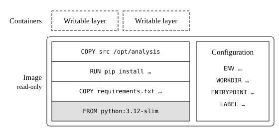

# About this document {#sec-about .unnumbered}

Docker has three concepts. A Dockerfile is the recipe of an image
(@sec-dockerfile). An image is a stack of read-only layers, built from a
Dockerfile or pulled from a registry (@sec-images). A container is a program
running in an image (@sec-running). The Docker daemon, a service with root
rights, builds the images, keeps them, and runs the containers; the `docker`
command only sends it requests. Working with Docker comes down to two steps:
build or pull the image, then run programs in it, either a command that ends or
a service that keeps running (@sec-service). The commands of the two steps are
few; the work lies in the Dockerfile, so this document starts with how one is
put together.

Layers connect the three concepts (@fig-layers). Each instruction of the
Dockerfile that changes files adds a layer on top of those of the base image,
and each container adds a writable layer of its own on top of those of its
image. Three things follow, and much of this document comes back to them: a
build reuses the layers that have not changed, and a file that a later layer
deletes still ships in the layer that added it (@sec-cache); what a container
writes into its own layer is lost with the container (@sec-running).

{#fig-layers}

This document covers what research software engineers need for these steps
regularly. Anything rarer, such as Compose, Swarm, or rootless mode, is in the
[documentation of Docker](https://docs.docker.com/). [](index.qmd) says when to
use Docker and states the rules that hold for every image.

Podman runs the same images with mostly the same commands, with `podman` in
place of `docker`, but without a daemon and without root rights. On macOS and
Windows, Docker Desktop runs Docker in a Linux virtual machine, with the same
commands.

Checked against Docker Engine 29.9.1.


# Dockerfiles {#sec-dockerfile}

A Dockerfile, a file named `Dockerfile`, is the recipe of an image. It is a
list of instructions, each a keyword, such as `RUN`, followed by its arguments,
which the build runs from top to bottom. The first, `FROM`, names the base image
to start from (@sec-from). The others are of three types, by when they take
effect. Build-time instructions run once, when the image is built, and decide
what the image holds, in layers (@sec-build-instructions). Run-time
instructions are stored in the image and take effect whenever a container
starts from it, and decide what the container does (@sec-run-instructions).
Metadata instructions do nothing: they are only stored in the image and
describe it (@sec-metadata-instructions). The last two set the configuration of
the image, which is stored beside its layers. Keep the Dockerfile in the
repository of the code it packages
([](../../principles/design.qmd#sec-recipe)).

```dockerfile
# The base image, pinned by its digest.
FROM python:3.12-slim@sha256:<digest>

# Build-time instructions, which run once, when the image is built.
# COPY and RUN each add a layer.
COPY requirements.txt /opt/requirements.txt
RUN pip install --no-cache-dir -r /opt/requirements.txt
COPY src /opt/analysis
RUN python -c "import numpy, pandas"

# Run-time instructions, which take effect whenever a container starts.
ENV LC_ALL=C.UTF-8
WORKDIR /results
ENTRYPOINT ["python", "/opt/analysis/run.py"]

# Metadata instructions, which are only stored in the image.
LABEL org.opencontainers.image.source=https://github.com/lab/analysis \
      org.opencontainers.image.version=1.2.0
```


## The base image {#sec-from}

`FROM` names the image to build on, such as `python:3.12-slim@sha256:<digest>`,
pinned by its digest ([](index.qmd#sec-pin)). The build pulls it from a
registry, Docker Hub unless the name starts with another, such as `ghcr.io`
(@sec-pull), and the new image starts with its layers. The base image brings
the operating system and often the language, such as Python in `python` or R in
`rocker/r-ver`; a `slim` variant leaves out what most programs do not need.
With `AS` and a name after the image, `FROM` starts a named stage (@sec-stages).


## Build-time instructions {#sec-build-instructions}

Build-time instructions run once, from top to bottom, when the image is built.
`COPY` and `RUN` each add a layer with the files they change, and `RUN` runs its
command in the image, as root unless `USER` names another user
(@sec-run-instructions):

| Instruction | Arguments |
|----------------|----------------------------------------------------------------|
| `COPY` | The paths of files or directories in the build context (@sec-cache), then their path in the image; with `--from`, paths in an earlier stage (@sec-stages) |
| `RUN` | A shell command that installs the software; the build stops if it fails |
| `ARG` | A variable of the build, such as a version, with its default, which `docker build --build-arg` changes; it adds no layer and does not exist in containers |

Docker has no instruction that tests the image, but a last `RUN` that imports
the packages, such as `RUN python -c "import numpy, pandas"`, stops the build
when the image is incomplete.


## Run-time instructions {#sec-run-instructions}

Run-time instructions are stored in the configuration of the image and take
effect whenever a container starts from it; only `WORKDIR` also adds a layer,
with its directory, if that does not exist yet. An instruction takes
effect from where it stands, so `ENV`, `WORKDIR`, and `USER` also apply to the
build-time instructions below them: a variable set by `ENV` exists in every
`RUN` that follows it, as well as in every container.

| Instruction | Arguments |
|----------------|----------------------------------------------------------------|
| `ENV` | Environment variables, as `NAME=value`, set in every container |
| `WORKDIR` | The directory that every container starts in, created if it does not exist |
| `USER` | The user that runs the program in every container; root without it (@sec-user) |
| `ENTRYPOINT` | The program that every container runs, as a list, such as `["python", "/opt/analysis/run.py"]`; `docker run` passes its arguments on to it |
| `CMD` | The default arguments of `ENTRYPOINT`, which those of `docker run` replace; without `ENTRYPOINT`, the default command |

Write `ENTRYPOINT` and `CMD` as lists. Written as a plain command, such as
`ENTRYPOINT python run.py`, the program runs in a shell, which does not pass on
the signal by which `docker stop` asks it to end, so Docker kills it after ten
seconds; an `ENTRYPOINT` written so also ignores the arguments of `docker run`.


## Metadata instructions {#sec-metadata-instructions}

Metadata instructions add no layer and do nothing: they are only stored in the
image, and `docker image inspect` shows them (@sec-inspect):

| Instruction | Arguments |
|----------------|----------------------------------------------------------------|
| `LABEL` | Labels, as `name=value`, such as the source and the version of the code |
| `EXPOSE` | The port that a service in the image listens on; it only documents the port, which `docker run -p` publishes (@sec-service) |


## Layers and the cache {#sec-cache}

The build keeps every layer in a cache. When an image is built again, the build
reuses each layer whose instruction and everything above it are unchanged, and
reruns every instruction from the first that has changed. For `COPY`, a change
is any change of the files it copies; for `RUN`, only a change of the text of
the command. Three consequences shape a Dockerfile:

**Order from stable to volatile.** Put what changes rarely at the top, such as
the system packages and the installation from the lock file, and the code at
the bottom. Copy only the lock file before the installation, as in the example
of @sec-dockerfile: a change of the code then reruns only the last `COPY`, not
the installation of the packages.

**A cached `RUN` does not look again.** `RUN apt-get update` reruns only when
its text changes, so the lists of packages it fetched can be months old when a
later `RUN apt-get install` uses them. Update and install in one `RUN`, and
build with `--no-cache` to get newer packages (@sec-build).

**Layers only add.** A file that a later instruction deletes still ships in the
layer that added it. Remove what an installation leaves behind in the same
`RUN`:

```dockerfile
RUN apt-get update \
    && apt-get install -y --no-install-recommends libhdf5-dev \
    && rm -rf /var/lib/apt/lists/*
```

For the same reason, never copy a secret, such as a token for a private
repository, into the image; `RUN --mount=type=secret` hands it to one command
without storing it.

`docker build` sends a directory, the build context, to the daemon, and `COPY`
can copy only from it. A file `.dockerignore` in it lists, like `.gitignore`,
what to leave out: the history of Git, virtual environments of the host, and
above all data and results, which would otherwise slow every build, end up in
the image with a `COPY` of the whole directory, and rerun everything below that
`COPY` whenever they change.

```default
.git
.venv
data
results
```


## Stages {#sec-stages}

A Dockerfile may hold several stages, one after the other, each starting with a
`FROM` of its own and named with `AS`. A stage takes files from an earlier one
with `COPY --from=` and its name, and only the last stage becomes the image,
without the layers of the others. A program can so be compiled in one stage,
with the compilers, and copied into a last stage that holds only what the
program needs to run:

```dockerfile
FROM debian:12-slim@sha256:<digest> AS build
RUN apt-get update && apt-get install -y gfortran make
COPY src /opt/src
RUN make -C /opt/src

FROM debian:12-slim@sha256:<digest>
RUN apt-get update \
    && apt-get install -y --no-install-recommends libgfortran5 \
    && rm -rf /var/lib/apt/lists/*
COPY --from=build /opt/src/simulate /usr/local/bin/simulate
ENTRYPOINT ["simulate"]
```


# Images {#sec-images}

An image is a stack of read-only layers together with its configuration, the
run-time and metadata instructions of its Dockerfile. Docker keeps its images
in a store of the daemon, not as files, and `docker image ls` lists them. An
image is named by a repository and a tag, such as `analysis:1.2.0`, or
`ghcr.io/lab/analysis:1.2.0` with the registry it belongs to; a name without a
tag means the tag `latest`. A tag can move to another image at any time, so only
the digest identifies an image: record it with the results
([](index.qmd#sec-record)).

Images, stopped containers, and the cache of the builds stay until they are
removed, and fill the disk over time. `docker system df` shows how much space
they take, and `docker system prune` removes the stopped containers, the images
that no tag names, and the cache.


## Build an image {#sec-build}

```bash
docker build -t analysis:1.2.0 .
```

`docker build` builds the image from the `Dockerfile` in the build context,
here the current directory `.` (@sec-cache), and `-t` names it. Tag an image
with the version of its code, not only with `latest`. `--no-cache` rebuilds
every layer, for example to get newer system packages. Build for the processor
architecture of the machines that run the image: on a Mac with Apple silicon,
Docker builds for ARM, and such an image does not run on an x86 machine, such
as most clusters and cloud machines. `--platform linux/amd64` builds for x86
instead, more slowly, in emulation.


## Pull and push an image {#sec-pull}

```bash
docker pull python:3.12-slim@sha256:<digest>
docker tag analysis:1.2.0 ghcr.io/lab/analysis:1.2.0
docker push ghcr.io/lab/analysis:1.2.0
```

A registry stores images and serves them to every machine that pulls them:
Docker Hub, for a name without a registry, such as `python`, or another, such
as `ghcr.io` of GitHub or `quay.io`. `docker pull` fetches an image, and
`docker run` and `docker build` fetch a missing one themselves. To push an
image, log in to the registry once with `docker login ghcr.io`, give the image
a name in it with `docker tag`, and push it. A pull or a push transfers only
the layers that the other side does not have yet. `docker push` prints the
digest of the image, by which any machine pulls exactly this image, such as
`ghcr.io/lab/analysis@sha256:<digest>`. On a cluster, Apptainer runs the same
image ([](apptainer.qmd#sec-pull)).


## Try things out in a container {#sec-try}

```bash
docker run --rm -it python:3.12-slim@sha256:<digest> bash
```

A container with a shell is the place to find out what an image needs: install
packages, run the program, and see what fails, as root. All of it is gone when
the shell ends, because `--rm` removes the container, so write each step that
worked into the Dockerfile and build the image from it; the cache keeps the
rebuilds short (@sec-cache). For an image with an `ENTRYPOINT`,
`--entrypoint bash` starts the shell instead of the program.

Do not turn such a container into the image you use, with `docker commit`. An
image changed by hand has no recipe
([](../../principles/design.qmd#sec-recipe)): `docker history` then shows only
the command that started the container, such as `bash`, not what was done in
it, and nobody can rebuild, fix, or update the image.


## Look inside an image {#sec-inspect}

```bash
docker history analysis:1.2.0                        # its layers
docker image inspect analysis:1.2.0                  # its configuration
docker image ls --digests ghcr.io/lab/analysis       # its digest
docker run --rm --entrypoint pip analysis:1.2.0 list # its Python packages
```

An image does not carry its Dockerfile: `docker history` lists the instructions
it was built from, with the size of each layer, and `docker image inspect`
shows its configuration, including the labels. The digest to record is the one
by which the registry serves the image, which `docker push` prints
(@sec-pull). Label the image with the source and the version of its code
(@sec-metadata-instructions), so that it leads back to its Dockerfile even when
it is found far from its repository. For R, `--entrypoint Rscript` with
`-e 'sessionInfo()'` lists the packages instead of `pip list`.


# Containers {#sec-running}

A container is a program running in an image, started with `docker run`. It
adds a writable layer of its own on top of the layers of the image
(@fig-layers), and whatever the program writes outside a mount goes into this
layer. A container is isolated from the host: of the files of the host, it sees
only the directories mounted into it (@sec-mounts), it gets none of the
environment variables of the host, and it reaches the network, but nothing
reaches it except on a published port (@sec-service). Its program runs as root,
unless the image or `docker run` names another user (@sec-user).

A container does not end with its program: a stopped container keeps its
writable layer until it is removed, and `docker ps --all` lists it. Start a
container that runs a command with `--rm`, which removes it when the program
ends, and let the program write its results into a mounted directory of the
host.


## Run a program {#sec-run}

```bash
docker run --rm analysis:1.2.0 --help                 # its ENTRYPOINT
docker run --rm -it --entrypoint bash analysis:1.2.0  # an interactive shell
docker exec -it model-api bash                        # a shell in a service
```

`docker run` runs the `ENTRYPOINT` of the image with the arguments after the
name of the image, or, for an image without one, these arguments as the
command, such as `docker run --rm python:3.12-slim python --version`.
`docker exec` runs a command in a container that is already running, such as a
service (@sec-service). The options of `docker run` go between `run` and the
image:

| Option | Does |
|----------------------------|--------------------------------------------------------|
| `--rm` | Removes the container when its program ends |
| `-it` | Connects the terminal, for an interactive program, such as a shell |
| `-v src:dest:ro` | Mounts the host path `src` at `dest`; `ro` read-only, `rw` the default (@sec-mounts) |
| `--user uid:gid` | Runs the program as this user instead of root (@sec-user) |
| `-e NAME=value`, `--env-file file` | Sets environment variables |
| `-w dir` | Starts in the directory `dir` inside the container |
| `--entrypoint prog` | Runs `prog` instead of the `ENTRYPOINT` of the image |
| `--cpus n`, `--memory size` | Limits the processors and the memory, such as `--cpus 8 --memory 16g`; without them, a container may use the whole machine |
| `--gpus all` | Makes the NVIDIA GPUs available (@sec-gpus) |
| `-d`, `--name`, `-p` | Runs in the background, names the container, publishes a port (@sec-service) |


## Run as your own user {#sec-user}

By default, the program in a container runs as root, and on Linux, the files it
writes into a mounted directory belong to root on the host as well: whoever ran
the container cannot change or delete them without `sudo`. Run every container
that writes into a mount as your own user, with `--user "$(id -u):$(id -g)"`.
That user has no home directory in the image, and `HOME` is `/`, where it may
not write; programs that keep a cache or settings there, such as Matplotlib or
pip, warn or fail, which `-e HOME=/tmp` avoids.

`USER` in the Dockerfile does not solve this: it names one user for every
machine, which is the user of the host only by chance. On macOS, Docker Desktop
gives the files written into a mount to the user of the host, so a command that
works on a Mac may leave files of root behind on a Linux server or in continuous
integration.


## Mount data {#sec-mounts}

```bash
docker run --rm --user "$(id -u):$(id -g)" -e HOME=/tmp \
    -v ./data:/data:ro \
    -v ./results:/results \
    --cpus 8 -e OMP_NUM_THREADS=8 \
    analysis:1.2.0 --input /data/samples.csv
```

`-v source:destination` mounts a directory of the host into the container, and
`:ro` makes it read-only. Mount only the directories a program reads and
writes, and its inputs read-only: a program that sees only its declared inputs
fails loudly when it reaches for anything else, and an input mounted read-only
cannot be changed by mistake ([](../../principles/design.qmd#sec-mutation)).

Mount to fixed paths inside the container, such as `/data` and `/results`, not
to the paths of the host: the commands inside the container are then the same
on every machine, and only the mounts change.

The source is a path, absolute or starting with `./`. A source without a slash,
such as `data`, is not a directory but the name of a volume, storage that Docker
manages itself: Docker creates an empty one, and the program sees an empty
`/data`, or writes its results where nobody looks for them. Volumes suit the
state of a service, such as a database (@sec-service), not data and results,
which belong in directories of the host.


## Use GPUs {#sec-gpus}

`--gpus all` makes the NVIDIA GPUs of the machine available in the container,
together with the driver of the host, and `--gpus device=0` only the first. The
host needs the NVIDIA Container Toolkit besides the driver. The image brings
CUDA and the libraries built on it, and the host brings the driver, so the CUDA
version in the image must be one that this driver supports; `nvidia-smi` on the
host shows the newest it supports.


## Run a service {#sec-service}

```bash
docker run -d --name model-api --restart unless-stopped \
    -p 127.0.0.1:8000:8000 -v /srv/models:/models:ro \
    ghcr.io/lab/model-api:1.0.0
docker logs -f model-api    # follow its output
docker stop model-api       # stop it; docker start starts it again
docker rm model-api         # remove it
```

A service, such as a web API that serves a model, keeps running until it is
stopped. It runs in the background with `-d` instead of `--rm`, under a name
given with `--name`, by which the other commands find it, and `docker ps` lists
it. `--restart unless-stopped` starts it again when it fails and when the
machine restarts, unless it was stopped with `docker stop`. `docker logs` shows
what the program writes to its standard output and error, and `docker exec`
runs a command in it (@sec-run).

`-p host:container` publishes a port of the container on the host. With an
address, as in `127.0.0.1:8000:8000`, the service is reachable only from the
machine itself, for example behind a web server that handles encryption and
logins; without one, as in `8000:8000`, from the whole network. Docker
publishes ports past the firewall of the host, such as ufw, so a rule that
closes a port there does not close it for a container.

A service keeps its state, such as a database, in a volume or a mounted
directory (@sec-mounts), never in its writable layer: a service is updated by
replacing its container with one of the new image, and the old layer goes with
the old container. To update it, pull or build the new image, stop and remove
the container, and start a new one with the same options.
